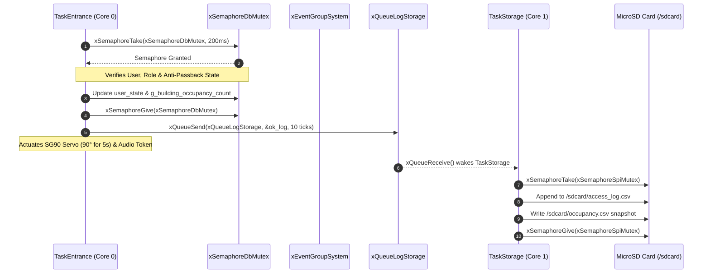

# Comprehensive System Architecture Specification
## Smart Control and Monitoring System for CoCIS (Makerere University)
### Group Reference: Group SE-24 | Target: Single-MCU ESP32 (FreeRTOS / ESP-IDF)

---

- **Project Title:** Smart Control and Monitoring System for the College of Computing and Information Sciences (CoCIS)
- **Institution:** Makerere University — Department of Computer Science & Software Engineering
- **Programmes:** Bachelor of Science in Software Engineering (BSE III) & Bachelor of Science in Computer Science (CS II)
- **Academic Year:** 2026/2027
- **Coursework Supervisor:** Dr. Mary Nsabagwa (`mnsabagwa@cit.ac.ug`)
- **Document Version:** 1.0 — Complete Technical System Architecture
- **Date of Freeze:** November 1, 2026

---

## 1. Architectural Scope & Design Philosophy

### 1.1 Problem Statement and Context
The College of Computing and Information Sciences (CoCIS) houses specialized computational laboratories, high-density server racks, and expensive educational infrastructure. The facility encounters two chronic operational issues:
1. **Security & Access Control Deficits:** Lack of automated bidirectional entry/exit validation, vulnerability to tailgating (passback), unmonitored after-hours occupancy, and absence of an automated emergency egress system.
2. **Excessive Electrical Consumption:** Classroom fluorescent fixtures remain active in empty lecture halls or during peak daylight hours when ambient solar illumination is sufficient.

Group SE-24 engineered an edge-embedded automation solution to resolve both challenges simultaneously through deterministic access control and daylight-harvesting energy management.

### 1.2 Transition from Multi-Node to Single-SoC RTOS Architecture
Following the formal guidance of course supervisor **Dr. Mary Nsabagwa** (clarification issued October 29, 2026), the system was consolidated from three distributed microcontrollers to a **Single ESP32 Dual-Core Edge Controller**.

Rather than physical radio frames over 2.4 GHz RF (which the free tier of the Wokwi simulation engine restricts to a single microcontroller instance), the system distributes the functional domains (**Main Entrance**, **Lecture Room 1**, and **Lecture Room 2**) across **independent, preemptive FreeRTOS tasks**. Communication and synchronization are handled deterministically via:
- **FreeRTOS Message Queues** (`QueueHandle_t`) for telemetry and audit streaming.
- **Event Groups** (`EventGroupHandle_t`) for atomic system-wide condition broadcasts.
- **Mutual Exclusion Semaphores** (`SemaphoreHandle_t`) for hardware bus arbitration and database integrity.

This design mirrors mission-critical embedded standards (e.g., AUTOSAR in automotive systems and ARINC-653 in avionics), where critical subsystems share a single fault-tolerant multicore processor.

---

## 2. Multi-Layer Architectural Breakdown

The system is organized into a four-tier architecture:

```
+====================================================================================================+
|                                4. APPLICATION & PRESENTATION LAYER                                 |
|   Interactive Serial CLI (UART0 115200 Baud)  |  Python Audio Companion (RFC2217 Port 4000 Bridge)  |
|   Role-Based Access Control (Public/Admin)    |  Studio Voice Announcements ('Access Granted/Denied')|
+====================================================================================================+
                                                  |
+====================================================================================================+
|                             3. REAL-TIME OPERATING SYSTEM (FreeRTOS) LAYER                         |
|   CORE 0 (Real-Time Safety & Actuation):      |   CORE 1 (Storage, CLI & Maintenance):              |
|     - TaskEmergency (Priority 5, 3072 B)      |     - TaskStorage (Priority 3, 4096 B)              |
|     - TaskEntrance  (Priority 5, 4096 B)      |     - TaskCLI     (Priority 2, 4096 B)              |
|     - TaskRoom1     (Priority 4, 3072 B)      |     - TaskHeartbeat (Priority 1, 2048 B)            |
|     - TaskRoom2     (Priority 4, 3072 B)      |                                                     |
|   IPC PRIMITIVES:                                                                                  |
|     - Queues: xQueueAccessEvents (16), xQueueTelemetry (16), xQueueLogStorage (32)                |
|     - Event Group: xEventGroupSystem (FLAG_EMERGENCY, CURFEW, INTRUSION, ADMIN)                    |
|     - Mutexes: xSemaphoreSpiMutex (Shared VSPI), xSemaphoreDbMutex (Occupancy & Records)           |
+====================================================================================================+
                                                  |
+====================================================================================================+
|                              2. HARDWARE ABSTRACTION & DRIVERS LAYER                               |
|   - Bare-Metal SPI MFRC522 Driver (Atomic REQA + Anti-collision ISO 14443-3A Engine)               |
|   - ESP-IDF LEDC PWM Driver (Timer 0 @ 50Hz for Servos; Timer 1 @ 1000Hz Pure Audio Tone Buzzers)  |
|   - ADC1 SAR Driver (12-bit, 12dB Attenuation, Oneshot Calibration for LDRs)                       |
|   - Inverted PNP Relay Drivers (Active-LOW Coil Control for Quad-LED Clusters)                     |
|   - ESP-IDF VFS FATFS SD-SPI Driver (/sdcard Access Logs & Occupancy Crash Recovery)               |
+====================================================================================================+
                                                  |
+====================================================================================================+
|                                   1. PHYSICAL HARDWARE LAYER                                       |
|   ESP32 DevKit V1 (Xtensa LX6 240MHz, 520KB SRAM, 4MB Flash)                                       |
|   Inputs:  2x MFRC522 Readers, 2x PIRs, 2x LDRs, 1x Emergency Button                               |
|   Outputs: 2x SG90 Servos, 2x 1000Hz Buzzers, 4x Gate LEDs, 2x PNP Relays (8 Lighting LEDs)       |
|   Storage: 1x MicroSD Card Module (VSPI)                                                           |
+====================================================================================================+
```

---

## 3. Physical Hardware Architecture & Electrical Interfacing

### 3.1 Hardware Block Diagram

```mermaid
graph TD
    subgraph MCU ["ESP32 Microcontroller (DevKit V1 / DevKitC V4)"]
        CPU0["Core 0 (Xtensa LX6 @ 240MHz)"]
        CPU1["Core 1 (Xtensa LX6 @ 240MHz)"]
        VSPI["VSPI Controller (SPI2_HOST)"]
        LEDC0["LEDC Timer 0 (50Hz PWM)"]
        LEDC1["LEDC Timer 1 (1000Hz PWM)"]
        ADC["ADC1 Unit (12-bit SAR)"]
        UART["UART0 Peripheral"]
        GPIO_BLK["GPIO Matrix & Interrupt Controller"]
    end

    subgraph Access_Inputs ["Access Control & Safety Inputs"]
        RFID1["Entry MFRC522\n(CS: GPIO 21)"]
        RFID2["Exit MFRC522\n(CS: GPIO 5)"]
        BTN_EMERG["Emergency Button\n(GPIO 32, Active-LOW)"]
    end

    subgraph Access_Outputs ["Access Control Actuators & Indicators"]
        SERVO_IN["Entry Barrier Servo\n(GPIO 13 - LEDC CH0)"]
        SERVO_OUT["Exit Barrier Servo\n(GPIO 15 - LEDC CH1)"]
        LED_IN_G["Entry Green LED (GPIO 2)"]
        LED_IN_R["Entry Red LED (GPIO 4)"]
        LED_OUT_G["Exit Green LED (GPIO 16)"]
        LED_OUT_R["Exit Red LED (GPIO 17)"]
        BUZ_IN["Entry Buzzer (GPIO 12 - LEDC CH2)"]
        BUZ_OUT["Exit Buzzer (GPIO 0 - LEDC CH3)"]
    end

    subgraph Room1_Zone ["Lecture Room 1 Zone"]
        PIR1["Room 1 PIR Motion (GPIO 14)"]
        LDR1["Room 1 LDR Sensor (GPIO 34 - ADC1_CH6)"]
        RELAY1["Room 1 PNP Relay (GPIO 26)"]
        LEDS_R1["4x Purple LEDs (Parallel Cluster)"]
    end

    subgraph Room2_Zone ["Lecture Room 2 Zone"]
        PIR2["Room 2 PIR Motion (GPIO 33)"]
        LDR2["Room 2 LDR Sensor (GPIO 35 - ADC1_CH7)"]
        RELAY2["Room 2 PNP Relay (GPIO 25)"]
        LEDS_R2["4x Blue LEDs (Parallel Cluster)"]
    end

    subgraph Storage_Zone ["Persistent Storage"]
        SD_CARD["MicroSD Card Module\n(CS: GPIO 27 | Shared VSPI)"]
    end

    subgraph Terminal_Zone ["Host Interface & Audio"]
        PC_UART["Host Console (TX: GPIO 1, RX: GPIO 3)"]
        PY_AUDIO["audio_companion.py (RFC2217 Port 4000)"]
    end

    %% Wiring
    VSPI ---|SCK:18, MISO:19, MOSI:23| RFID1
    VSPI ---|SCK:18, MISO:19, MOSI:23| RFID2
    VSPI ---|SCK:18, MISO:19, MOSI:23| SD_CARD
    GPIO_BLK -->|CS:21, RST:22| RFID1
    GPIO_BLK -->|CS:5, RST:22| RFID2
    GPIO_BLK -->|CS:27| SD_CARD
    BTN_EMERG --> GPIO_BLK

    LEDC0 --> SERVO_IN
    LEDC0 --> SERVO_OUT
    LEDC1 --> BUZ_IN
    LEDC1 --> BUZ_OUT
    GPIO_BLK --> LED_IN_G
    GPIO_BLK --> LED_IN_R
    GPIO_BLK --> LED_OUT_G
    GPIO_BLK --> LED_OUT_R

    PIR1 --> GPIO_BLK
    LDR1 --> ADC
    GPIO_BLK --> RELAY1
    RELAY1 --> LEDS_R1

    PIR2 --> GPIO_BLK
    LDR2 --> ADC
    GPIO_BLK --> RELAY2
    RELAY2 --> LEDS_R2

    UART <--> PC_UART
    PC_UART -.-> PY_AUDIO
```



### 3.2 Electrical Schematics & Pin Assignment Matrix

| GPIO Pin | Pad Name | Direction / Mode | Peripheral | Subsystem | Electrical Notes & Pull Resistors |
| :---: | :---: | :---: | :---: | :---: | :--- |
| **GPIO 0** | GPIO0 | Output (LEDC CH3) | Exit Buzzer | Access Control | Safe post-boot output; 1000Hz 50% duty tone generator. |
| **GPIO 1** | U0TXD | Output (UART0) | Host PC Terminal | Admin Interface | Serial CLI transmit (115200-8-N-1). |
| **GPIO 2** | GPIO2 | Output (Push-Pull) | Entry Green LED | Main Entrance | Access Granted indicator. Internal pull-down safe during boot. |
| **GPIO 3** | U0RXD | Input (UART0) | Host PC Terminal | Admin Interface | Serial CLI receive. |
| **GPIO 4** | GPIO4 | Output (Push-Pull) | Entry Red LED | Main Entrance | Access Denied / Lockout warning LED. |
| **GPIO 5** | VSPICS0 | Output (Push-Pull) | Exit RFID CS | Access Control | Dedicated Chip Select for Exit MFRC522 reader. Active LOW. |
| **GPIO 12** | MTDI | Output (LEDC CH2) | Entry Buzzer | Access Control | 1000Hz tone. Initialized to 0 duty to prevent boot strapping error. |
| **GPIO 13** | MTCK | Output (LEDC CH0) | Entry Servo | Main Entrance | 50Hz PWM: 0° closed (500μs), 90° open (1450μs). |
| **GPIO 14** | MTMS | Input (Pull-down) | Room 1 PIR | Lecture Room 1 | Digital motion sensor; internal pull-down enabled. |
| **GPIO 15** | MTDO | Output (LEDC CH1) | Exit Servo | Main Entrance | 50Hz PWM: 0° closed (500μs), 90° open (1450μs). |
| **GPIO 16** | GPIO16 | Output (Push-Pull) | Exit Green LED | Exit Gate | Access Granted indicator for outbound corridor. |
| **GPIO 17** | GPIO17 | Output (Push-Pull) | Exit Red LED | Exit Gate | Access Denied / Curfew indicator for outbound corridor. |
| **GPIO 18** | VSPICLK| Output (VSPI) | Shared SPI SCK | Shared SPI Bus | Serial clock driven up to 5 MHz for RFID and 20 MHz for SD. |
| **GPIO 19** | VSPIMISO| Input (VSPI) | Shared SPI MISO | Shared SPI Bus | Master In Slave Out line shared across 3 peripherals. |
| **GPIO 21** | GPIO21 | Output (Push-Pull) | Entry RFID CS | Main Entrance | Dedicated Chip Select for Entry MFRC522 reader. Active LOW. |
| **GPIO 22** | GPIO22 | Output (Push-Pull) | Shared RFID RST | Access Control | Hardware reset line tied to both MFRC522 readers. |
| **GPIO 23** | VSPID | Output (VSPI) | Shared SPI MOSI | Shared SPI Bus | Master Out Slave In line shared across 3 peripherals. |
| **GPIO 25** | GPIO25 | Output (Active-LOW)| Room 2 Relay | Lecture Room 2 | Controls PNP transistor relay driving 4 blue LEDs. LOW=ON. |
| **GPIO 26** | GPIO26 | Output (Active-LOW)| Room 1 Relay | Lecture Room 1 | Controls PNP transistor relay driving 4 purple LEDs. LOW=ON. |
| **GPIO 27** | GPIO27 | Output (Push-Pull) | MicroSD CS | Storage System | Dedicated Chip Select for MicroSD Card module. Active LOW. |
| **GPIO 32** | 32K_XN | Input (Pull-up) | Emergency Button | Safety System | Debounced pushbutton; falling edge initiates evacuation. |
| **GPIO 33** | 32K_XP | Input (Pull-down) | Room 2 PIR | Lecture Room 2 | Digital motion sensor; internal pull-down enabled. |
| **GPIO 34** | VDET_1 | Input (Analog) | Room 1 LDR | Lecture Room 1 | ADC1_CH6 (12-bit SAR ADC). Range 0–4095 mapped to 0–1000 lux. |
| **GPIO 35** | VDET_2 | Input (Analog) | Room 2 LDR | Lecture Room 2 | ADC1_CH7 (12-bit SAR ADC). Range 0–4095 mapped to 0–1000 lux. |

### 3.3 Pin Safety, Strapping Pins & Electrical Isolation
1. **Flash Isolation:** GPIOs 6 through 11 connect internally to the SPI flash silicon inside the ESP32 module. They are completely excluded from pin maps.
2. **Input-Only Pins (GPI 34 & 35):** These pins lack output drivers and internal pull-up/pull-down circuitry. They are dedicated exclusively to **ADC1 Channels 6 and 7** for analog voltage reading from LDR photoresistors. Because ADC1 is used, there is no conflict with Wi-Fi/Bluetooth hardware blocks.
3. **Strapping Pin Handling:**
   - **GPIO 0:** Used as an output for Buzzer 2. Defaults to floating during boot to permit normal flash booting.
   - **GPIO 2:** Connected to Entry Green LED with an internal pull-down. Must remain LOW during boot for UART download mode bypass; this matches the un-energized LED state.
   - **GPIO 12:** MTDI pin. Must not be pulled HIGH during boot or flash voltage will be set incorrectly (1.8V vs 3.3V). Configured as an active-low LEDC buzzer channel that begins at 0% duty.
   - **GPIO 15:** MTDO pin. Silently boots into normal flash operation.
4. **Shared Bus Arbitration:** The VSPI bus (`SCK:18`, `MISO:19`, `MOSI:23`) connects three slave chips in parallel. Dedicated Chip Select lines (`GPIO 21`, `GPIO 5`, `GPIO 27`) ensure only one slave drives `MISO` at any clock edge.

---

## 4. Software Concurrency & Task Scheduling Architecture

The firmware utilizes **Preemptive Priority-Based Scheduling** with time slicing under the FreeRTOS kernel.

### 4.1 Task Priority & Hardware Affinity Matrix

```
 Priority 5 [HIGHEST] ----+---> TaskEmergency (Core 0, 3072 B, 50ms Debounce)
                          +---> TaskEntrance  (Core 0, 4096 B, 150ms Poll)
 Priority 4 [HIGH] -------+---> TaskRoom1     (Core 0, 3072 B, 1000ms Loop)
                          +---> TaskRoom2     (Core 0, 3072 B, 1000ms Loop)
 Priority 3 [NORMAL] -----+---> TaskStorage   (Core 1, 4096 B, Queue-Driven)
 Priority 2 [LOW] --------+---> TaskCLI       (Core 1, 4096 B, 50ms Poll)
 Priority 1 [IDLE] -------+---> TaskHeartbeat (Core 1, 2048 B, 5000ms Periodic)
```

| Task Identifier | Pinned Core | Priority | Stack Depth | Blocking Primitive | Rationale for Priority & Core Assignment |
| :--- | :---: | :---: | :---: | :--- | :--- |
| **`TaskEmergency`** | Core 0 | 5 | 3,072 B | `vTaskDelay(50ms)` | Immediate response to physical evacuation button; must preempt normal room control. |
| **`TaskEntrance`** | Core 0 | 5 | 4,096 B | `vTaskDelay(150ms)` | Fast RFID scanning and servo response; must not experience jitter from storage writes. |
| **`TaskRoom1`** | Core 0 | 4 | 3,072 B | `vTaskDelay(1000ms)`| Periodic sensor acquisition and daylight-harvesting calculations for Room 1. |
| **`TaskRoom2`** | Core 0 | 4 | 3,072 B | `vTaskDelay(1000ms)`| Periodic sensor acquisition and daylight-harvesting calculations for Room 2. |
| **`TaskStorage`** | Core 1 | 3 | 4,096 B | `xQueueReceive(xQueueLogStorage)` | Heavy FATFS filesystem write operations; pinned to Core 1 so SD writes never block Core 0. |
| **`TaskCLI`** | Core 1 | 2 | 4,096 B | `vTaskDelay(50ms)` | Human-speed interactive command parsing and telemetry table formatting. |
| **`TaskHeartbeat`** | Core 1 | 1 | 2,048 B | `vTaskDelay(5000ms)`| Diagnostic watchdog; monitors FreeRTOS heap memory and scheduler health. |

### 4.2 Inter-Process Communication (IPC) Design
The system uses three synchronization paradigms:



1. **Message Queues:**
   - `xQueueAccessEvents` (Length: 16 items of `access_event_t`): Passes card tap events from `TaskEntrance` to monitoring subsystems.
   - `xQueueTelemetry` (Length: 16 items of `room_telemetry_t`): Passes periodic room status frames (`room_id`, `lux`, `relay_state`, `countdown`, `kwh_saved`) from room tasks to CLI console.
   - `xQueueLogStorage` (Length: 32 items of `log_entry_t`): Buffer queue delivering formatted CSV strings to `TaskStorage` for file serialization without blocking the access terminal.
2. **Event Groups (`xEventGroupSystem`):**
   - `FLAG_EMERGENCY_ACTIVE` (`BIT 0`): Broadcasts global evacuation override across all tasks.
   - `FLAG_CURFEW_LOCKED` (`BIT 1`): Broadcasts after-hours curfew lockdown.
   - `FLAG_INTRUSION_ALARM` (`BIT 2`): Triggers 60-second lockout warning state.
   - `FLAG_ADMIN_LOGGED_IN` (`BIT 3`): Asserts elevated administrative privilege on CLI.
3. **Mutexes:**
   - `xSemaphoreSpiMutex`: Recursive-safe mutex arbitrating the shared VSPI bus between two MFRC522 readers and the MicroSD card.
   - `xSemaphoreDbMutex`: Guards the user database table and `g_building_occupancy_count` against concurrent modifications.

---

## 5. Subsystem Implementation & Behavioral Logic

### 5.1 Entrance Access Control Engine ([`src/access_entrance.c`](file:///c:/Users/ASUS/Desktop/SE-24-CoCIS-Smart-System/src/access_entrance.c))

#### Custom Atomic MFRC522 Driver
Standard MFRC522 libraries fail in Wokwi because Wokwi resets virtual card state whenever the chip goes to `IDLE`. Group SE-24 engineered a custom, bare-metal atomic driver (`mfrc522_detect_and_read_uid`):
- **Step 1 (REQA):** Writes `0x26` to FIFO with 7-bit framing to transition virtual cards from `IDLE` to `READY`.
- **Step 2 (Anti-Collision):** Immediately issues Cascade Level 1 command (`0x93 0x20`) within the same session to retrieve the 4-byte UID without letting the card return to `IDLE`.
- **Rising-Edge Filter:** Implements `card_was_present` tracking so holding a card on the reader executes exactly one validation.

#### 7-Stage Validation Pipeline
When a card is tapped:
1. **Intrusion Lockout Check:** If current tick is within `s_lockout_end_tick`, scan is instantly rejected and denial alarm triggered.
2. **Emergency Route Check:** If `g_emergency_evacuation_active == true`:
   - `DIR_ENTRY` $\rightarrow$ Denied with alarm (no inward access during evacuation).
   - `DIR_EXIT` $\rightarrow$ Unconditionally granted to ensure egress.
3. **Database Search:** Case-insensitive hex matching against registered users in `s_local_users[]`.
4. **Invalid Attempt Increment:** If unrecognized, increment counter. If counter reaches 3:
   - System enters **60-second hardware lockout lockdown**.
   - Asserts `FLAG_INTRUSION_ALARM` and triggers 3 audible alarm beeps.
5. **Curfew Evaluation:** If `g_system_schedule.curfew_enforced == true`, scan is denied and flagged as a curfew violation.
6. **Anti-Passback Verification:**
   - Entry scan attempted by user already marked `STATE_INSIDE` $\rightarrow$ **DENIED (Anti-Passback Violation)**.
   - Exit scan attempted by user already marked `STATE_OUTSIDE` $\rightarrow$ **DENIED (Anti-Passback Violation)**.
7. **Access Granted:**
   - Invalid counter reset to 0.
   - User state flipped (`STATE_INSIDE` $\leftrightarrow$ `STATE_OUTSIDE`).
   - Occupancy count updated (`g_building_occupancy_count++` or `--`).
   - Emits `[AUDIO_TRIGGER:ACCESS_GRANTED]` on serial port.
   - Green LED ON $\rightarrow$ 3s audio pause $\rightarrow$ Servo swings 0° to 90° for 5 seconds $\rightarrow$ Closes to 0° $\rightarrow$ Green LED OFF.
   - Formatted record queued to `xQueueLogStorage`.

### 5.2 Smart Energy Management & Daylight Harvesting ([`src/room_lighting.c`](file:///c:/Users/ASUS/Desktop/SE-24-CoCIS-Smart-System/src/room_lighting.c))

#### Daylight-Harvesting Algorithm
To eliminate lighting waste in rooms with ample natural sunlight, lighting relies on dual-factor condition:
$$\text{Relay State} = \begin{cases} \text{ON (GPIO LOW)}, & \text{if } (\text{Occupancy} == \text{TRUE}) \land (\text{Ambient Lux} < 250) \\ \text{OFF (GPIO HIGH)}, & \text{otherwise} \end{cases}$$

1. **PIR Detection:** Digital HIGH on `GPIO 14` (Room 1) or `GPIO 33` (Room 2) flags room as occupied and initializes `countdown_sec = 30`.
2. **Continuous Motion Retriggering:** Every subsequent PIR pulse resets `countdown_sec` back to 30.
3. **Lux Evaluation:** ADC1 converts voltage (0–4095) from LDR voltage divider to lux (0–1000):
   $$\text{Lux} = \frac{\text{Raw ADC Value} \times 1000}{4095}$$
   - If $\text{Lux} \ge 250$, the room is marked **Occupied with Daylight Inhibit**. The relay remains OFF, and power savings accumulate.
4. **Inverted PNP Relay Driving:** Relays are active-LOW:
   - Drive `GPIO LOW` (0) $\rightarrow$ PNP transistor conducts $\rightarrow$ Relay coil energizes $\rightarrow$ NO contacts close $\rightarrow$ 4 LEDs illuminate.
   - Drive `GPIO HIGH` (1) $\rightarrow$ PNP transistor shuts off $\rightarrow$ Relay coil de-energizes $\rightarrow$ Lights extinguish.
5. **Energy Accumulator Formula:**
   Assumes a standard classroom lighting load of two 50W fluorescent fixtures (100W total = 0.100 kW):
   $$\text{Cumulative kWh Saved} = \frac{0.100\text{ kW} \times \text{Seconds Lights Kept OFF}}{3600\text{ s/hr}}$$

### 5.3 Emergency Evacuation Override ([`src/emergency_mgr.c`](file:///c:/Users/ASUS/Desktop/SE-24-CoCIS-Smart-System/src/emergency_mgr.c))

The emergency system enforces immediate life-safety overrides:
1. **Debounced Trigger:** `TaskEmergency` monitors `GPIO 32` (active-LOW pushbutton) with a 50ms software debounce filter to eliminate electrical bounce on boot.
2. **Asymmetric Barrier Control:**
   - **Exit Gate (`GPIO 15`):** Immediately swings to 90° and stays open, providing an unobstructed evacuation route. Exit Green LED stays solidly ON.
   - **Entry Gate (`GPIO 13`):** Held locked at 0° (closed barrier line). Entry Green LED is forced OFF to block crowd entry.
3. **Visibility Override:** Both Room 1 (`GPIO 26`) and Room 2 (`GPIO 25`) relays are driven LOW, turning on all 8 classroom LEDs to full brightness regardless of ambient lux or vacancy timers.
4. **Dual Siren Pulsing:** Both buzzers (`GPIO 12` and `GPIO 0`) pulse in a 200ms ON / 150ms OFF siren cadence.
5. **Atomic De-escalation:** Pressing the emergency button a second time clears `FLAG_EMERGENCY_ACTIVE`, returns the exit servo to 0°, silences sirens, and returns classroom relays to sensor automation.

---

## 6. Persistent Storage & Crash Recovery Architecture ([`src/storage_manager.c`](file:///c:/Users/ASUS/Desktop/SE-24-CoCIS-Smart-System/src/storage_manager.c))

### 6.1 Virtual File System (VFS) Integration
The MicroSD card is mounted at `/sdcard` via ESP-IDF FATFS using SPI host `SPI2_HOST`:
- Max concurrent files: 5
- Allocation unit size: 16 KB
- Pinned Chip Select: `GPIO 27`

### 6.2 Database Schemas
The storage manager persists two continuous CSV databases:

#### 1. Forensic Audit Log: `/sdcard/access_log.csv`
```csv
timestamp,tag_id,name,direction,decision,reason
2026-10-31 22:00:01,TAG_1001,Kayeera Nathan,ENTRY,GRANTED,Authorized Validation
2026-10-31 22:01:14,TAG_1002,Kasozi David,ENTRY,GRANTED,Authorized Validation
2026-10-31 22:01:25,TAG_1002,Kasozi David,ENTRY,DENIED,Anti-Passback Violation
2026-10-31 22:05:10,UNKNOWN,UNKNOWN,ENTRY,DENIED,Unregistered Tag
2026-10-31 22:10:00,SYSTEM,RED_EMERGENCY_BUTTON,EMERGENCY,ACTIVATED,Evacuation Route Open
```

#### 2. Atomic Crash Recovery Register: `/sdcard/occupancy.csv`
```csv
building_count,timestamp
2,2026-10-31 22:00:00
```

### 6.3 Power-Loss Crash Recovery Engine
When power is unexpectedly cut or an ESP32 watchdog reset occurs, all volatile RAM variables (`g_building_occupancy_count`, user inside/outside states) are lost.
- On boot, `perform_crash_recovery()` opens `/sdcard/occupancy.csv`.
- Parses the last known headcount and restores `g_building_occupancy_count` into RAM before any access gates are unlocked.
- **Graceful Fallback:** If the MicroSD card fails to mount or is absent in simulation, `storage_manager_init()` outputs a warning and directs all audit logs to console output without asserting or crashing the microcontroller.

---

## 7. Interactive Serial CLI & Security Specification ([`src/cli_console.c`](file:///c:/Users/ASUS/Desktop/SE-24-CoCIS-Smart-System/src/cli_console.c))

Operates on `UART0` (`TX: GPIO 1`, `RX: GPIO 3`) at 115,200 baud with styled ANSI terminal escape sequences.

### 7.1 Role-Based Access Control (RBAC) Matrix

| Command | Arguments | Required Role | Subsystem Impact | Output Description |
| :--- | :--- | :---: | :--- | :--- |
| `help` | None | Public | Informational | Lists all commands, syntax, and permission levels. |
| `status` | None | Public | Diagnostics | Prints uptime (s), free heap memory (bytes), occupancy, curfew, emergency, and admin session. |
| `occupancy` | None | Public | Monitoring | Prints current building headcount inside the building. |
| `rooms` | None | Public | Monitoring | Displays live telemetry: Occupancy (YES/NO), Ambient Lux, Lights (ON/OFF), and 30s Countdown. |
| `energy` | None | Public | Monitoring | Displays cumulative energy conserved (kWh) by automation for Room 1, Room 2, and total. |
| `schedule show` | None | Public | Monitoring | Displays current allowed building hours (e.g. 07:00–20:00) and curfew enforcement state. |
| `login` | `<user> <pass>` | Public | Security | Verifies credentials (`admin` / `se24`). Sets `FLAG_ADMIN_LOGGED_IN` and starts 300s timeout. |
| `logout` | None | Admin Only | Security | Terminating admin session and revoking elevated privileges. |
| `tap` | `<in\|out> <tag>`| Public | Simulation | Injects a simulated card tap into `process_card_tap()` for rapid software testing. |
| `schedule set` | `<SH:SM> <EH:EM>` | Admin Only | Configuration | Updates building operating hours in RAM. |
| `curfew` | `<on\|off>` | Admin Only | Security | Activates/deactivates after-hours curfew lockdown, locking all doors. |
| `emergency` | `<on\|off>` | Admin Only | Safety | Manually activates or de-escalates system-wide evacuation override state. |
| `logs` | None | Admin Only | Audit | Prints recent access logs from storage. |

### 7.2 Session Inactivity Auto-Logout
To prevent terminal hijacking if an administrator leaves the console unattended, `TaskCLI` compares tick counts on every incoming keystroke against `s_admin_login_tick`. If inactivity exceeds `CLI_SESSION_TIMEOUT_SEC` (300 seconds = 5 minutes), administrative privileges are automatically revoked.

---

## 8. Real Studio Audio Companion Subsystem ([`audio_companion.py`](file:///c:/Users/ASUS/Desktop/SE-24-CoCIS-Smart-System/audio_companion.py))

To deliver clear, studio-grade speech during academic evaluation and oral defense, Group SE-24 implemented an external companion bridge:

```
[ ESP32 Firmware (Wokwi Engine) ]
               |
  Emits Serial Trigger Tokens over UART0
  - "[AUDIO_TRIGGER:ACCESS_GRANTED]"
  - "[AUDIO_TRIGGER:ACCESS_DENIED]"
               |
               v
[ Wokwi RFC2217 Telnet Server (127.0.0.1:4000) ]
               |
               v
[ Python Bridge Script: audio_companion.py ]
               |
  Asynchronously calls Windows native winsound / OS player
               |
               +---> Plays 'Acess_granted.mp3' / 'access_granted.wav'
               |     (Crystal-Clear Voice: "Access granted", NO ALARM)
               |
               +---> Plays 'Access_denaid.mp3' / 'access_denied.wav'
                     (Crystal-Clear Voice: "Access denied" + Siren)
```

1. **RFC2217 Telnet Bridge:** Configured via `wokwi.toml` (`rfc2217ServerPort = 4000`), allowing `audio_companion.py` to stream bidirectional UART packets over TCP.
2. **Zero-Latency Audio Playback:** The script precaches uncompressed PCM WAV files (`access_granted.wav` and `access_denied.wav`) at 44.1 kHz, playing asynchronously via `winsound.SND_ASYNC` without blocking serial monitoring.
3. **Interactive Control Console:** Includes manual trigger shortcuts (`1` for Access Granted, `2` for Access Denied, `T` for audio test) for rapid demonstration without physical card inputs.

---

## 9. Failure Modes, Fault Tolerance & Edge Cases

| Failure Scenario | Hardware / Software Detection | System Response & Mitigation |
| :--- | :--- | :--- |
| **MicroSD Card Hardware Failure** | `esp_vfs_fat_sdspi_mount()` returns non-OK status. | System logs warning, automatically initializes building occupancy to 0, and directs audit logs to RAM/console fallback without crashing. |
| **Consecutive Unknown Card Taps** | `s_entry_invalid_scans >= 3`. | 60-second hardware lockout lockdown (`FLAG_INTRUSION_ALARM`). All further scans during this period are rejected; buzzer sounds warning beeps. |
| **Card Handback / Tailgating** | Anti-Passback state mismatch (`STATE_INSIDE` user scanning at Entry). | Scan is rejected; Red LED illuminates for 3 seconds; incident is logged as `Anti-Passback Violation`. |
| **Power Brownout / Unplanned Reset** | Hardware brownout detector resets ESP32. | On boot, `perform_crash_recovery()` reads `/sdcard/occupancy.csv` and restores true headcount into RAM. |
| **Emergency Pushbutton Glitch** | Electrical noise on long wiring lines during boot. | `TaskEmergency` executes 500ms startup settling delay followed by 50ms falling-edge debounce verification. |
| **Curfew Egress Attempt** | Card scanned at exit during `curfew_enforced == true`. | System denies exit, locking after-hours occupants inside and logging a curfew security breach. |
| **SPI Bus Contention** | Multiple tasks attempting simultaneous SPI operations. | All SPI operations are guarded by `xSemaphoreSpiMutex` with timeout delays. |

---

## 10. Coursework Section-by-Section Compliance

| Coursework Section & Requirement | Implementation Details in Group SE-24 System | Primary Module |
| :--- | :--- | :---: |
| **2.1: Access Control & Occupancy Monitoring** | Inbound and outbound corridors with dedicated MFRC522 readers, SG90 PWM servos, anti-passback tracking, and live headcount counter. | `src/access_entrance.c` |
| **2.2: Automated Lighting Control** | Dual-room PIR motion detection, active-low PNP relays, and non-blocking 30-second vacancy auto-shutoff countdown. | `src/room_lighting.c` |
| **2.3: Microcontroller Architecture** | Lecturer-approved Single-ESP32 architecture running 7 preemptive FreeRTOS tasks mapped to distinct CPU cores. | `src/main.c` |
| **2.4: Data Storage and Management** | MicroSD Card SPI FATFS logging `/sdcard/access_log.csv` and atomic snapshot `/sdcard/occupancy.csv`. | `src/storage_manager.c` |
| **2.5: Serial Interface & Management Menus** | Full-duplex UART0 CLI console at 115,200 baud with ANSI color menus and real-time telemetry tables. | `src/cli_console.c` |
| **2.6: Configurable Building Access Schedule** | Configurable operating schedule with after-hours curfew lockdown restricting both entry and unmonitored exit. | `src/cli_console.c` |
| **2.7: Resource Synchronization & Reliability**| 3 FreeRTOS queues, 1 24-bit event group, and 2 mutexes preventing race conditions across cores and shared buses. | `include/project_config.h` |
| **Section 6: Innovation Criteria** | 1. Atomic bare-metal MFRC522 driver bypassing simulation bugs.<br>2. Dual-core deterministic hardware affinity.<br>3. Daylight harvesting with ADC1 ambient lux inhibit threshold.<br>4. Power-loss crash recovery engine.<br>5. Real crystal-clear studio voice companion. | Entire Codebase |

---
*Group SE-24 — Makerere University CoCIS Smart Control & Monitoring System — Technical Specification Document.*
