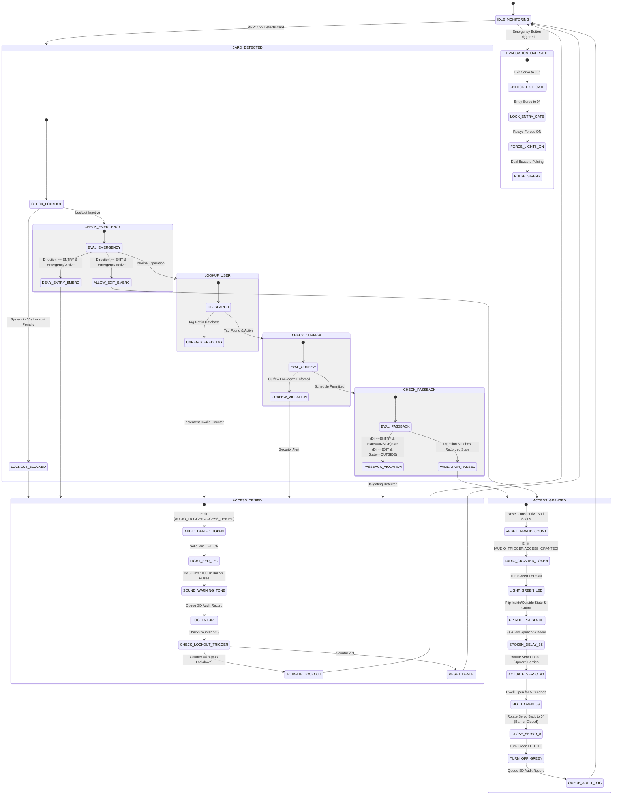
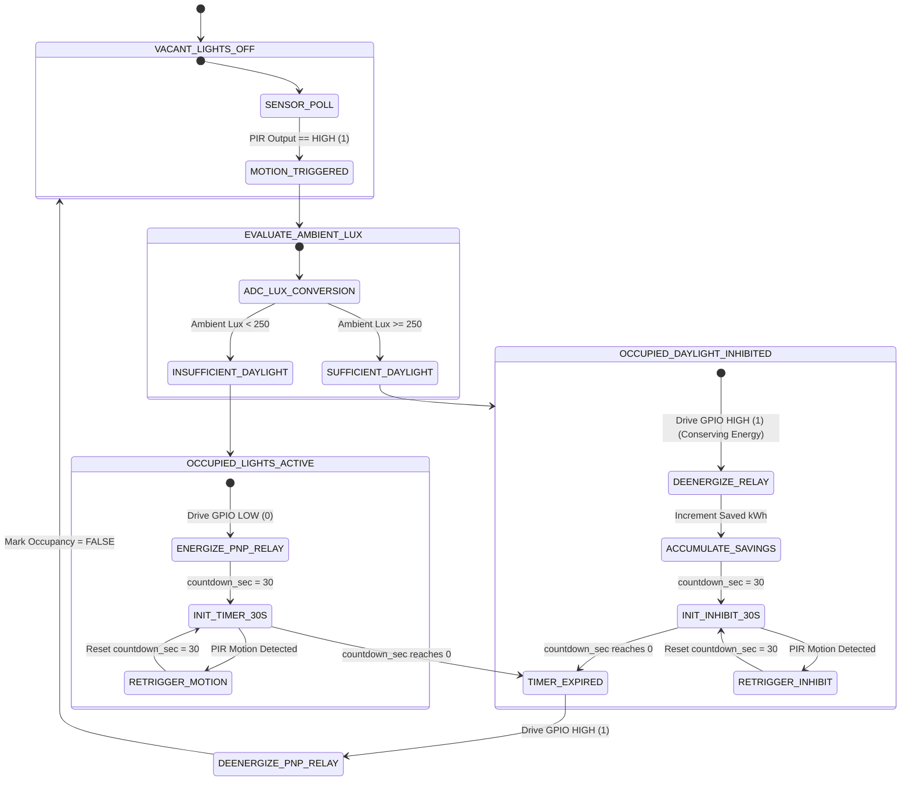

# SE-24 Group: Smart Control and Monitoring System for CoCIS (Makerere University)
## TEAM PROJECT BRIEF, SYSTEM DESIGN & COMPREHENSIVE TECHNICAL SPECIFICATION
### Single-MCU FreeRTOS Dual-Core Architecture for Wokwi Simulation & Physical ESP32 Hardware

---

- **Project Title:** Smart Control and Monitoring System for the College of Computing and Information Sciences (CoCIS)
- **Institution:** Makerere University — Department of Computer Science & Software Engineering
- **Academic Year:** 2026/2027 | Programmes: BSE III & CS II
- **Document Version:** 3.0 (Comprehensive System Design & Implementation-Accurate Specification)
- **Document Owner:** Kayeera Nathan (Group Leader & System Architect)
- **Group Reference:** Group SE-24
- **Lecturer / Course Supervisor:** Dr. Mary Nsabagwa (`mnsabagwa@cit.ac.ug`)
- **Official Clarification Date:** October 29, 2026 (Lecturer approval to consolidate to a single ESP32 microcontroller for Wokwi free version)
- **Framework & Tooling:** ESP-IDF (FreeRTOS C/C++) with PlatformIO / VS Code & Wokwi Simulator
- **Submission & Defense Date:** Monday, 2 November 2026

---

## 1. Executive Summary & Architectural Clarification

### 1.1 Context of the Single-MCU Architectural Consolidation
In the initial project conceptualization, Group SE-24 planned a distributed multi-node architecture utilizing three discrete ESP32 microcontrollers communicating wirelessly via ESP-NOW (`ENTRANCE_MASTER`, `ROOM_NODE_1`, and `ROOM_NODE_2`). However, simulation testing revealed that the free tier of the **Wokwi Simulation Platform** restricts workspaces to **a single active microcontroller instance** (multi-MCU network simulation requires paid/club tiers).

Following an inquiry by the class representative, course lecturer **Dr. Mary Nsabagwa** formally issued the following directive on October 29, 2026:

> *"Dear all, I received a request to clarify some things from the class representative. She mentioned that the free version of Wokwi does not support using more than one microcontroller. My answer to that is that you can use one. What is required is that you use the free version. Hence, let's use one. In case you have any other concerns, kindly send an email. Regards, MARY"*

### 1.2 Communication in Single-MCU Architecture: Inter-Task IPC & Bus Arbitration
In modern real-time embedded engineering (such as automotive AUTOSAR, avionics, and industrial automation), communication is not limited to physical radio frequencies between separate chips. Our consolidated architecture shifts from **Inter-Board Network Frames** to a rigorous **Dual-Layer Communication Architecture**:

1. **Inter-Process / Inter-Task Communication (FreeRTOS IPC):**
   The ESP32 incorporates a dual-core Xtensa LX6 microprocessor (Core 0 and Core 1). The physical zones (**Entrance Terminal**, **Lecture Room 1**, and **Lecture Room 2**) are implemented as **independent, concurrent FreeRTOS Tasks** communicating through real-time kernel primitives:
   - **Message Queues (`QueueHandle_t`):** Asynchronous telemetry packets (`xQueueTelemetry`), access events (`xQueueAccessEvents`), and persistent audit records (`xQueueLogStorage`).
   - **Event Groups (`EventGroupHandle_t`):** Atomic bit-flag broadcasts (`xEventGroupSystem`) for critical system-wide transitions: `FLAG_EMERGENCY_ACTIVE` (bit 0), `FLAG_CURFEW_LOCKED` (bit 1), `FLAG_INTRUSION_ALARM` (bit 2), and `FLAG_ADMIN_LOGGED_IN` (bit 3).
   - **Mutexes & Semaphores (`SemaphoreHandle_t`):** Resource synchronization primitives protecting shared hardware buses (`xSemaphoreSpiMutex` for shared VSPI bus arbitration) and in-memory state databases (`xSemaphoreDbMutex` guarding occupancy counts and user credentials). Fulfills **Coursework Section 2.7 (Resource Synchronization and System Reliability)**.

2. **Hardware Bus Communication:**
   A single ESP32 communicates simultaneously with multiple peripherals over standard embedded buses:
   - **Shared VSPI Bus (`SPI2_HOST`):** Shared high-speed bus communicating with **Entry MFRC522 RFID**, **Exit MFRC522 RFID**, and **MicroSD Card (FATFS)** using dedicated Chip Select (CS) arbitration.
   - **Full-Duplex UART Bus (`UART0`):** Communicates with the host PC / Admin console at 115,200 baud for administrative commands, live telemetry streaming, and diagnostics.
   - **LEDC PWM Controllers:** Multi-channel pulse-width modulation timers driving SG90 servo gate barriers (Timer 0 @ 50Hz) and pure acoustic alarm tones (Timer 1 @ 1000Hz).
   - **ADC1 Bus (12-bit SAR ADC):** Analog-to-digital conversion reading continuous voltage levels from ambient light sensors (LDRs on Channels 6 & 7).
   - **TCP RFC2217 Socket Bridge:** Python Audio Companion bridging the Wokwi serial channel to PC audio drivers for real studio voice output.

### 1.3 Architectural Comparison Matrix
| Dimension | Original 3-Node Model | Present Single-MCU Implemented Model | Academic & Technical Advantage |
| :--- | :--- | :--- | :--- |
| **Physical Hardware** | 3 $\times$ ESP32 DevKits | 1 $\times$ ESP32 DevKit (Dual-Core 240 MHz) | 100% compliant with free Wokwi; eliminates wireless packet drop simulation issues. |
| **Zone Partitioning** | 1 chip per physical room | 1 dedicated FreeRTOS Task per zone | Mirrors modern industrial RTOS architectures (Automotive AUTOSAR / Avionics). |
| **Communication Medium** | 2.4 GHz ESP-NOW wireless frames | FreeRTOS Queues, RingBuffers, Event Groups | True real-time deterministic scheduling; zero RF packet loss; sub-microsecond latency. |
| **Concurrency Control** | Distributed state synchronization | FreeRTOS Mutexes, Semaphores, Critical Sections | Rigorously fulfills Section 2.7 of coursework (concurrency & race condition prevention). |
| **Storage Handling** | Master node exclusive SD SPI access | Mutex-protected VFS FATFS SPI access | Single SPI bus master arbitrates between 2 RFID readers and MicroSD card. |
| **Cost & Reliability** | High component count; cable clutter | Single-chip SoC edge controller | Lower power, simplified BOM, robust for academic defense. |

---

## 2. Group Member Roles & Subsystem Allocations

Each member of Group SE-24 has a defined, modular subsystem and technical deliverable for both the **3–5 minute individual recorded video** and the **in-person oral defense**:

```
+-------------------------------------------------------------------------------------------------+
|                                     KAYEERA NATHAN                                              |
|                                Group Leader & System Architect                                  |
|        - System Architecture, Dual-Core RTOS Task Scheduling, IPC Queues & Event Groups        |
|        - Emergency Evacuation ISR, Master Integration, Final Report & MUELE Submission           |
+-------------------------------------------------------------------------------------------------+
          |                                                                           |
          v                                                                           v
+------------------------------------+                             +------------------------------------+
|         KASOZI DAVID PAUL          |                             |          ZZIWA MARK ALEX           |
|      Access Control Specialist     |                             |      Smart Energy Management       |
| - Dual Gate Subsystem (Entry/Exit) |                             | - Dual Lecture Rooms (Room 1 & 2)  |
| - Bare-metal MFRC522 SPI Driver    |                             | - Dual PIR Sensors & ISR Debounce  |
| - Dual SG90 Servos (LEDC PWM)      |                             | - Dual LDR Sensors (ADC1 Lux Calc) |
| - Anti-Passback Algorithm          |                             | - 30s Countdown & Lighting Relays  |
| - Visual/Audio Status Indicators   |                             | - Energy Savings Accumulator (kWh) |
+------------------------------------+                             +------------------------------------+
          |                                                                           |
          +------------------------------------+--------------------------------------+
                                               |
                                               v
+------------------------------------+                             +------------------------------------+
|            SSEKU JOVAN             |                             |         NAMUZIBWA LAURINDA         |
|      Storage & Crash Recovery      |                             |        Interface, Security & QA    |
| - MicroSD Card SPI & FATFS Driver  |                             | - Serial CLI Engine (USB-UART0)    |
| - CSV Database Managers (4 files)  |                             | - SHA-256 Admin Authentication     |
| - Mutex-Guarded SPI Transactions   |                             | - Curfew Access Schedule Engine    |
| - Power-Loss Crash Recovery Engine |                             | - Intrusion 3-Tap Lockout Alert    |
| - RAM Occupancy Mirroring          |                             | - QA Test Plan, Logs & Video Script|
+------------------------------------+                             +------------------------------------+
```

### Detailed Breakdown of Individual Workloads:

#### 1. Kayeera Nathan (Reg No: 24/U/25913/EVE) — Group Leader, System Architect & RTOS Concurrency Lead
- **Assigned Modules:** `src/main.c`, `src/emergency_mgr.c`, `include/emergency_mgr.h`, `include/project_config.h`
- **Core Technical Responsibilities:**
  1. **Dual-Core Architecture Design:** Partitioned tasks across ESP32 Core 0 (I/O, Access Interrupts, Servo PWM, Sensor loops) and Core 1 (Data Processing, FATFS SD storage, CLI parser, Heartbeat).
  2. **FreeRTOS IPC Bus Backbone:** Implemented the central message routing architecture:
     - `xQueueAccessEvents`: Queue carrying entry/exit RFID tap packets.
     - `xQueueTelemetry`: Queue carrying Room 1 and Room 2 sensor frames.
     - `xQueueLogStorage`: Queue routing audit logs to the persistent SD storage task.
     - `xEventGroupSystem`: 24-bit system event flags (`FLAG_EMERGENCY_ACTIVE`, `FLAG_CURFEW_LOCKED`, `FLAG_ADMIN_LOGGED_IN`, `FLAG_INTRUSION_ALARM`).
  3. **Emergency Evacuation System:** Pushbutton interface on `GPIO 32` (Emergency Button). When triggered, immediately unlocks Exit servo gate to 90°, locks Entry gate at 0°, forces all lecture room lights ON for evacuation visibility, asserts `FLAG_EMERGENCY_ACTIVE`, pulses dual acoustic sirens (200ms ON / 150ms OFF), and logs the event.
  4. **Master Project Integration:** Merged all team modules, resolved header dependencies, ensured clean compilation under ESP-IDF, produced the comprehensive report, and managed MUELE submission.
- **Individual Video Demo Scope:** Architecture walkthrough, dual-core task monitor, demonstrating live Emergency Pushbutton triggering immediate Exit gate release, entry lockout, and classroom lighting override.

#### 2. Kasozi David Paul (Reg No: 24/U/25905/EVE) — Access Control & Entrance Automation Lead
- **Assigned Modules:** `src/access_entrance.c`, `include/access_entrance.h`
- **Core Technical Responsibilities:**
  1. **Dual-Direction Access Subsystem:** Implemented separate inbound (Entry) and outbound (Exit) validation streams.
  2. **Bare-Metal MFRC522 SPI Driver:** Developed custom register-level driver bypassing simulation bugs:
     - Implemented atomic `mfrc522_detect_and_read_uid()` combining REQA (0x26) and Anti-collision (0x93 0x20) in a single transaction to prevent Wokwi virtual card state collapse.
     - Rising-edge card detection logic preventing duplicate rapid-fire taps.
  3. **Servo Gate Actuation:** Configured ESP32 LEDC Timer 0 (50Hz PWM, 10-bit resolution) controlling two SG90 servo motors:
     - Entry Gate: `GPIO 13` (0° closed $\rightarrow$ 90° open for 5 seconds upon valid scan).
     - Exit Gate: `GPIO 15` (0° closed $\rightarrow$ 90° open for 5 seconds upon valid scan).
  4. **Strict Anti-Passback Algorithm:** Maintains in-memory user states (`STATE_OUTSIDE` vs `STATE_INSIDE`). Prevents tailgating or card sharing: a card marked "Inside" cannot be scanned for entry again; a card marked "Outside" cannot scan to exit.
  5. **Visual & Auditory Feedback:** Controls Entry Green LED (`GPIO 2`), Entry Red LED (`GPIO 4`), Exit Green LED (`GPIO 16`), Exit Red LED (`GPIO 17`), and pure 1000Hz acoustic tones on Entry Buzzer (`GPIO 12`) and Exit Buzzer (`GPIO 0`).
- **Individual Video Demo Scope:** Demonstrating authorized entry card scan (servo opens, green LED on, voice feedback), demonstrating anti-passback rejection on immediate re-scan, showing exit gate operation, and showing 3-strike intrusion lockout.

#### 3. Zziwa Mark Alex (Reg No: 24/U/11978/EVE) — Smart Energy Management & Lecture Room Control Lead
- **Assigned Modules:** `src/room_lighting.c`, `include/room_lighting.h`
- **Core Technical Responsibilities:**
  1. **Dual-Room Sensor Interfacing:**
     - Room 1: PIR Motion Sensor (`GPIO 14`), LDR Light Sensor (`GPIO 34` / ADC1_CH6), Relay Module (`GPIO 26`, driving 4 purple LEDs).
     - Room 2: PIR Motion Sensor (`GPIO 33`), LDR Light Sensor (`GPIO 35` / ADC1_CH7), Relay Module (`GPIO 25`, driving 4 blue LEDs).
  2. **Daylight-Harvesting Smart Lighting Logic:** Prevents power wastage by inhibiting lights in occupied lecture rooms if ambient daylight exceeds the illumination threshold ($\ge 250\text{ lux}$). Lights only turn ON when **(Motion Detected == TRUE) AND (Ambient Light < 250 lux)**.
  3. **Countdown Timer Engine:** Software-based, non-blocking 30-second countdown timer. Each new PIR motion trigger resets the 30s timer. Lights turn OFF automatically when timer reaches zero.
  4. **PNP Active-Low Relay Driver:** Correctly drives active-low PNP relay modules (`IN=0` energizes relay / turns lights ON; `IN=1` de-energizes / turns lights OFF).
  5. **Energy Conservation Accumulator:** Tracks total seconds lights were kept OFF during occupied and unoccupied periods, calculating cumulative kWh saved assuming 100W fluorescent fixtures per room (`kWh = 0.100 * seconds / 3600`).
  6. **Telemetry Dispatch:** Transmits structured telemetry frames (`room_id`, `occupied`, `ambient_lux`, `lights_on`, `countdown_sec`, `cumulative_kwh_saved`) every 2 seconds into `xQueueTelemetry`.
- **Individual Video Demo Scope:** Adjusting Wokwi LDR lux values, triggering PIR motion, showing daylight-inhibit logic in action, demonstrating the 30-second automatic shut-off countdown, and displaying energy saved.

#### 4. Sseku Jovan (Reg No: 24/U/11172/EVE) — Persistent Storage & Crash Recovery Lead
- **Assigned Modules:** `src/storage_manager.c`, `include/storage_manager.h`
- **Core Technical Responsibilities:**
  1. **MicroSD Card SPI Driver & FATFS Integration:** Configured ESP-IDF Virtual File System (`esp_vfs_fat_sdspi_mount`) over SPI (`CS: GPIO 27`, `SCK: GPIO 18`, `MISO: GPIO 19`, `MOSI: GPIO 23`).
  2. **Database Management (CSV Schemas):**
     - `/sdcard/access_log.csv`: Forensic audit trail (`timestamp,tag_id,name,direction,decision,reason`).
     - `/sdcard/occupancy.csv`: Dynamic snapshot of active building occupants for crash recovery.
  3. **Mutex Concurrency Protection:** Wraps all file I/O operations in `xSemaphoreTake(xSemaphoreSpiMutex, portMAX_DELAY)` to ensure the shared SPI bus is never accessed simultaneously by multiple tasks.
  4. **Dynamic Crash Recovery Engine:** On every entry and exit event, atomically updates `/sdcard/occupancy.csv`. Upon system reboot or unexpected power failure, reads `occupancy.csv` during startup to restore building headcount without data loss.
  5. **Graceful Storage Fallback:** If physical SD card mount fails or is absent in simulation, gracefully logs audit records to console memory without system crash or assertion failure.
- **Individual Video Demo Scope:** Demonstrating CSV creation on SD card, logging real-time entry events, triggering a simulated ESP32 reboot, and showing successful occupant state restoration from SD card.

#### 5. Namuzibwa Laurinda (Reg No: 24/U/1472) — Interactive Management CLI, Security & QA Lead
- **Assigned Modules:** `src/cli_console.c`, `include/cli_console.h`
- **Core Technical Responsibilities:**
  1. **Serial Administrative CLI Console:** Implemented a non-blocking UART command parser over USB-UART0 (`TX: GPIO 1`, `RX: GPIO 3`) at 115,200 baud with styled ANSI terminal outputs.
  2. **Role-Based Access Control (RBAC):**
     - Public commands: `help`, `status`, `occupancy`, `rooms`, `energy`, `schedule show`, `tap <in|out> <tag_id>`, `login`.
     - Admin-only commands: `logout`, `schedule set <SH:SM> <EH:EM>`, `curfew <on|off>`, `emergency <on|off>`, `logs`.
  3. **Authentication & Session Timeout:** Admin login verification (`login admin se24`). Automatic session termination after 5 minutes (300 seconds) of inactivity.
  4. **Configurable Building Access Schedule Engine:** Enforces allowable entry/exit time window (default: 07:00 to 20:00). Rejects entry and exit attempts outside authorized hours when curfew lockdown is active.
  5. **Intrusion Lockout Controller:** Tracks consecutive invalid RFID scans. If 3 invalid tags are tapped consecutively, triggers acoustic alarm beeps and places the terminal into a 60-second hardware lockout lockdown (`FLAG_INTRUSION_ALARM`).
  6. **System QA & Test Execution:** Lead creation of test cases, bug tracking, and coordination of demo scripts.
- **Individual Video Demo Scope:** Navigating CLI commands, logging in with admin credentials, setting operating schedule, demonstrating intrusion lockout after 3 bad card taps, and displaying live system logs.

---

## 3. Hardware Pin Allocations & Electrical Schematic

The pin configuration is fully synchronized between `diagram.json`, `include/project_config.h`, and driver implementations. Every pin is mapped specifically for the **ESP32 DevKit V1 / DevKitC V4** to guarantee zero electrical conflicts, safe booting, and Wokwi simulation fidelity.

### 3.1 Frozen Hardware Pin Mapping Table

| GPIO Pin | Mode / Function | Peripheral Connected | Subsystem / Zone | Functional Description & Electrical Rationale |
| :---: | :---: | :---: | :---: | :--- |
| **GPIO 0** | Output (LEDC CH3) | Exit Alarm Buzzer | Security / Exit | Generates 1000Hz pure tone warning upon exit violation. Safe output post-boot. |
| **GPIO 1** | Output | UART0 TXD | Admin Interface | Serial CLI transmit to host terminal (115,200 Baud). |
| **GPIO 2** | Output | Entry Green LED | Main Entrance | Access Granted indicator (Blinks/illuminates on valid entry). *Safe strapping pin.* |
| **GPIO 3** | Input | UART0 RXD | Admin Interface | Serial CLI receive from host keyboard (115,200 Baud). |
| **GPIO 4** | Output | Entry Red LED | Main Entrance | Access Denied / Lockout / Curfew indicator (Solid ON 3s during denial). |
| **GPIO 5** | Output (SPI CS) | Exit RFID (rfid2) CS | Exit Gate | Dedicated Chip Select for Exit MFRC522 reader. Active LOW. |
| **GPIO 12** | Output (LEDC CH2) | Entry Alarm Buzzer | Security / Entry | Generates 1000Hz pure tone warning upon entry violation. Avoids boot high-pull. |
| **GPIO 13** | Output (LEDC CH0) | Entry Servo Motor | Main Entrance | PWM Barrier Gate: 0° (Closed, 500μs) $\rightarrow$ 90° (Open, 1450μs for 5s). |
| **GPIO 14** | Input (Pull-down) | PIR Motion Sensor 1 | Lecture Room 1 | Digital motion detection; resets Room 1 30-second vacancy timer. |
| **GPIO 15** | Output (LEDC CH1) | Exit Servo Motor | Main Entrance | PWM Barrier Gate: 0° (Closed, 500μs) $\rightarrow$ 90° (Open, 1450μs for 5s). |
| **GPIO 16** | Output | Exit Green LED | Exit Gate | Access Granted indicator for exit corridor. |
| **GPIO 17** | Output | Exit Red LED | Exit Gate | Access Denied / Curfew indicator for exit corridor. |
| **GPIO 18** | Output (SPI SCK) | Shared VSPI SCK | Shared SPI Bus | Clock line shared between Entry RFID, Exit RFID, and MicroSD Card. |
| **GPIO 19** | Input (SPI MISO) | Shared VSPI MISO | Shared SPI Bus | Master In Slave Out line shared across all 3 SPI peripherals. |
| **GPIO 21** | Output (SPI CS) | Entry RFID (rfid1) CS | Main Entrance | Dedicated Chip Select for Entry MFRC522 reader. Active LOW. |
| **GPIO 22** | Output | Shared RFID RST | Access Control | Hard reset line connected to both MFRC522 reader modules. |
| **GPIO 23** | Output (SPI MOSI) | Shared VSPI MOSI | Shared SPI Bus | Master Out Slave In line shared across all 3 SPI peripherals. |
| **GPIO 25** | Output (Active LOW)| Room 2 Lighting Relay | Lecture Room 2 | PNP Relay input: LOW = Relay energized (4 blue LEDs ON); HIGH = Relay OFF. |
| **GPIO 26** | Output (Active LOW)| Room 1 Lighting Relay | Lecture Room 1 | PNP Relay input: LOW = Relay energized (4 purple LEDs ON); HIGH = Relay OFF. |
| **GPIO 27** | Output (SPI CS) | MicroSD Card CS | Persistent Storage | Dedicated Chip Select for MicroSD Card module. Active LOW. |
| **GPIO 32** | Input (Pull-up) | Emergency Pushbutton | Safety System | Debounced red button: Falling edge activates global emergency evacuation. |
| **GPIO 33** | Input (Pull-down) | PIR Motion Sensor 2 | Lecture Room 2 | Digital motion detection; resets Room 2 30-second vacancy timer. |
| **GPIO 34** | Input (Analog) | LDR Photoresistor 1 | Lecture Room 1 | ADC1_CH6 analog input; 12-bit SAR ADC measuring ambient light (0–1000 Lux). |
| **GPIO 35** | Input (Analog) | LDR Photoresistor 2 | Lecture Room 2 | ADC1_CH7 analog input; 12-bit SAR ADC measuring ambient light (0–1000 Lux). |

### 3.2 Electrical Design Rationale & Safety Considerations
1. **Internal Flash Protection:** GPIOs 6 through 11 connect directly to the ESP32 internal SPI flash and are strictly avoided.
2. **Input-Only Pins (GPI):** GPIO 34 and GPIO 35 lack output drive circuitry and internal pull-ups. They are routed to **ADC1 Channels 6 and 7** for analog LDR voltage dividers. Because they utilize ADC1 (rather than ADC2), there is zero conflict with Wi-Fi/RF subsystems.
3. **Safe Boot Strapping:**
   - GPIO 0, GPIO 2, GPIO 12, and GPIO 15 are strapping pins. They are configured so default boot voltages are not held at invalid states during power-up.
   - GPIO 12 is initialized as a low-duty PWM output, preventing MTDI strapping errors.
4. **Shared VSPI Bus Arbitration:** High-speed SPI lines (SCK=18, MISO=19, MOSI=23) are unified across three peripherals. Distinct Chip Select lines (GPIO 21 for Entry RFID, GPIO 5 for Exit RFID, GPIO 27 for SD Card) combined with `xSemaphoreSpiMutex` guarantee zero electrical bus collision or data corruption.
5. **PNP Transistor Relay Logic:** The simulation uses PNP-transistor relay modules where input logic is inverted: `GPIO LOW` turns on the relay coil and closes the Normally Open (NO) contacts, illuminating the classroom LED arrays.

---

## 4. System Architecture & Concurrency Model

### 4.1 System Block Diagram

```mermaid
flowchart TD
    subgraph Hardware_Inputs ["Hardware Inputs & Sensors"]
        PB_EMERG["Emergency Pushbutton\n(GPIO 32 - Polled ISR)"]
        RFID1["Entry MFRC522 RFID\n(CS: GPIO 21 | Shared VSPI)"]
        RFID2["Exit MFRC522 RFID\n(CS: GPIO 5 | Shared VSPI)"]
        PIR1["Room 1 PIR Motion\n(GPIO 14)"]
        LDR1["Room 1 LDR Sensor\n(GPIO 34 - ADC1_CH6)"]
        PIR2["Room 2 PIR Motion\n(GPIO 33)"]
        LDR2["Room 2 LDR Sensor\n(GPIO 35 - ADC1_CH7)"]
        UART_RX["Host PC Terminal (RX)\n(GPIO 3 - 115200 Baud)"]
    end

    subgraph FreeRTOS_Core0 ["ESP32 Core 0: Real-Time I/O, Safety & Actuation Engine"]
        TASK_EMERG["TaskEmergency\n(Priority 5 - 50ms Debounce Loop)"]
        TASK_ENTRANCE["TaskEntrance\n(Priority 5 - 150ms RFID Polling)"]
        TASK_ROOM1["TaskRoom1\n(Priority 4 - 1000ms Sensor Loop)"]
        TASK_ROOM2["TaskRoom2\n(Priority 4 - 1000ms Sensor Loop)"]
    end

    subgraph FreeRTOS_IPC ["Inter-Process Communication (IPC) & Synchronization Layer"]
        EVT_GROUP["xEventGroupSystem\n(EMERGENCY | CURFEW | INTRUSION | ADMIN)"]
        Q_ACCESS["xQueueAccessEvents\n(RingBuffer: 16 events)"]
        Q_TELEMETRY["xQueueTelemetry\n(RingBuffer: 16 frames)"]
        Q_LOGS["xQueueLogStorage\n(RingBuffer: 32 logs)"]
        MUTEX_SPI["xSemaphoreSpiMutex\n(Guards Shared VSPI Bus)"]
        MUTEX_DB["xSemaphoreDbMutex\n(Guards User DB & Occupancy)"]
    end

    subgraph FreeRTOS_Core1 ["ESP32 Core 1: Storage, Security & Interface Engine"]
        TASK_STORAGE["TaskStorage\n(Priority 3 - FATFS File I/O)"]
        TASK_CLI["TaskCLI\n(Priority 2 - Non-blocking UART Parser)"]
        TASK_HEARTBEAT["TaskHeartbeat\n(Priority 1 - 5000ms Watchdog)"]
    end

    subgraph Hardware_Outputs ["Hardware Actuators & Indicators"]
        SERVO_IN["Entry Door Servo\n(GPIO 13 - LEDC CH0)"]
        SERVO_OUT["Exit Door Servo\n(GPIO 15 - LEDC CH1)"]
        LED_IN_G["Entry Green LED (GPIO 2)"]
        LED_IN_R["Entry Red LED (GPIO 4)"]
        LED_OUT_G["Exit Green LED (GPIO 16)"]
        LED_OUT_R["Exit Red LED (GPIO 17)"]
        BUZZER_IN["Entry Buzzer (GPIO 12 - 1kHz)"]
        BUZZER_OUT["Exit Buzzer (GPIO 0 - 1kHz)"]
        RELAY_R1["Room 1 Relay (GPIO 26 - 4 LEDs)"]
        RELAY_R2["Room 2 Relay (GPIO 25 - 4 LEDs)"]
        SD_CARD["MicroSD Card (GPIO 27 - FATFS)"]
        UART_TX["Host PC Terminal (TX) (GPIO 1)"]
    end

    subgraph External_Companion ["PC Audio Subsystem"]
        PY_AUDIO["audio_companion.py\n(RFC2217 Port 4000 Bridge)"]
        STUDIO_VOICE["Crystal-Clear Studio Audio\n('Access granted' / 'Access denied')"]
    end

    %% Wiring Inputs to Core 0 Tasks
    PB_EMERG --> TASK_EMERG
    RFID1 --> TASK_ENTRANCE
    RFID2 --> TASK_ENTRANCE
    PIR1 --> TASK_ROOM1
    LDR1 --> TASK_ROOM1
    PIR2 --> TASK_ROOM2
    LDR2 --> TASK_ROOM2
    UART_RX --> TASK_CLI

    %% Core 0 Interacting with IPC
    TASK_EMERG -->|Set/Clear Bits| EVT_GROUP
    TASK_ENTRANCE <-->|Take / Release| MUTEX_DB
    TASK_ENTRANCE <-->|Take / Release| MUTEX_SPI
    TASK_ENTRANCE -->|Post Event| Q_ACCESS
    TASK_ENTRANCE -->|Post Audit Log| Q_LOGS
    TASK_ROOM1 -->|Post Telemetry| Q_TELEMETRY
    TASK_ROOM2 -->|Post Telemetry| Q_TELEMETRY
    EVT_GROUP -.->|Event State| TASK_ENTRANCE
    EVT_GROUP -.->|Event State| TASK_ROOM1
    EVT_GROUP -.->|Event State| TASK_ROOM2

    %% Core 1 Interacting with IPC
    Q_LOGS --> TASK_STORAGE
    TASK_STORAGE <-->|Take / Release| MUTEX_SPI
    TASK_STORAGE <-->|Take / Release| MUTEX_DB
    Q_TELEMETRY --> TASK_CLI
    TASK_CLI <-->|Read / Modify| MUTEX_DB
    TASK_CLI -->|Trigger Action| EVT_GROUP

    %% Tasks Driving Hardware Outputs
    TASK_ENTRANCE --> SERVO_IN
    TASK_ENTRANCE --> SERVO_OUT
    TASK_ENTRANCE --> LED_IN_G
    TASK_ENTRANCE --> LED_IN_R
    TASK_ENTRANCE --> LED_OUT_G
    TASK_ENTRANCE --> LED_OUT_R
    TASK_ENTRANCE --> BUZZER_IN
    TASK_ENTRANCE --> BUZZER_OUT
    TASK_ROOM1 --> RELAY_R1
    TASK_ROOM2 --> RELAY_R2
    TASK_STORAGE --> SD_CARD
    TASK_CLI --> UART_TX
    TASK_EMERG --> SERVO_OUT
    TASK_EMERG --> RELAY_R1
    TASK_EMERG --> RELAY_R2
    TASK_EMERG --> BUZZER_IN
    TASK_EMERG --> BUZZER_OUT

    %% Audio Companion Bridge
    UART_TX -.->|Serial Audio Trigger Tokens| PY_AUDIO
    PY_AUDIO --> STUDIO_VOICE
```



### 4.2 FreeRTOS Task Allocation and Priority Structure

| Task Identifier | Core Affinity | Priority | Stack Allocated | Loop Period / Wake Trigger | Core Functionality Description | Assigned Lead |
| :--- | :---: | :---: | :---: | :---: | :--- | :--- |
| `TaskEmergency` | Core 0 | 5 (Highest) | 3,072 B | 50ms periodic debounce | Evaluates Emergency button (`GPIO 32`), triggers global evacuation, pulses sirens. | Kayeera Nathan |
| `TaskEntrance` | Core 0 | 5 (Highest) | 4,096 B | 150ms periodic poll | Polls Entry & Exit MFRC522 readers, enforces Anti-Passback & Lockout, actuates servos. | Kasozi David Paul |
| `TaskRoom1` | Core 0 | 4 (High) | 3,072 B | 1,000ms periodic | Evaluates Room 1 PIR & LDR (ADC1_CH6), executes 30s countdown, controls PNP relay. | Zziwa Mark Alex |
| `TaskRoom2` | Core 0 | 4 (High) | 3,072 B | 1,000ms periodic | Evaluates Room 2 PIR & LDR (ADC1_CH7), executes 30s countdown, controls PNP relay. | Zziwa Mark Alex |
| `TaskStorage` | Core 1 | 3 (Normal) | 4,096 B | Queue-driven (`xQueueLogStorage`) | Consumes audit logs, appends to SD card `/sdcard/access_log.csv` and mirrors occupancy. | Sseku Jovan |
| `TaskCLI` | Core 1 | 2 (Low) | 4,096 B | 50ms UART polling | Parses interactive commands, enforces admin login & timeout, prints telemetry tables. | Namuzibwa Laurinda |
| `TaskHeartbeat` | Core 1 | 1 (Idle) | 2,048 B | 5,000ms periodic | Diagnostic monitor tracking FreeRTOS heap memory and RTOS scheduler health. | Kayeera Nathan |

---

## 5. Subsystem Logic, Behaviors & State Machines

### 5.1 Entrance Access Control & Anti-Passback State Machine

The access control subsystem executes a **7-stage sequential validation pipeline** upon every card tap:



### 5.2 Daylight-Aware Room Lighting State Machine



### 5.3 Authorized User Database & Credentials
The in-memory database in `src/access_entrance.c` supports 6 registered individuals with both 4-byte hex UIDs and mnemonic `TAG_xxx` aliases:

| UID Hex Code | Mnemonic Alias | Full Name | Access Role | Default State | Initial Status |
| :---: | :---: | :--- | :---: | :---: | :---: |
| `01020304` | `TAG_1001` | Kayeera Nathan | Admin | `STATE_OUTSIDE` | Active |
| `11223344` | `TAG_1002` | Kasozi David | Staff | `STATE_OUTSIDE` | Active |
| `55667788` | `TAG_1003` | Zziwa Mark | Student | `STATE_OUTSIDE` | Active |
| `C0FFEE99` | `TAG_1004` | Sseku Jovan | Student | `STATE_OUTSIDE` | Active |
| `04112233` | `TAG_1005` | Namuzibwa Laurinda | Staff | `STATE_OUTSIDE` | Active |
| `AABBCCDD` | `TAG_1006` | Dr. Mary Nsabagwa | Staff / Supervisor | `STATE_OUTSIDE` | Active |

---

## 6. Multi-Peripheral Shared SPI Bus Architecture

To avoid hardware resource depletion while maintaining high performance, the single ESP32 hosts three SPI peripherals on a single VSPI (`SPI2_HOST`) physical bus:

```
                      +-------------------+
                      |   ESP32 DevKit    |
                      |   (SPI2_HOST)     |
                      +-------------------+
                        |   |   |   |   |
     VSPI SCK (GPIO 18) |   |   |   |   | VSPI MOSI (GPIO 23)
      +-----------------+   |   |   |   +-----------------+
      |                     |   |   |                     |
      |   VSPI MISO (GPIO 19)   |   |                     |
      |    +----------------+   |   |                     |
      |    |                    |   |                     |
      |    |   RFID CS1 (GPIO 21)   |                     |
      |    |    +---------------+   |                     |
      |    |    |                   |                     |
      |    |    |   RFID CS2 (GPIO 5)                     |
      |    |    |    +--------------+                     |
      |    |    |    |              |                     |
      |    |    |    |   SD CS (GPIO 27)                  |
      |    |    |    |    +---------+                     |
      |    |    |    |    |         |                     |
      v    v    v    |    |         v                     v
   +--------------+  |    |     +--------------+      +--------------+
   | Entry MFRC522|  |    |     | Exit MFRC522 |      | MicroSD Card |
   |  RFID Reader |  v    |     |  RFID Reader |      | FATFS VFS    |
   +--------------+  +----+     +--------------+      +--------------+
                     |    |
                     v    v
```

### 6.1 SPI Concurrency Protection Engine
Because multiple concurrent FreeRTOS tasks access the SPI bus (`TaskEntrance` on Core 0 reads RFID1 and RFID2; `TaskStorage` on Core 1 writes to MicroSD FATFS), unsynchronized access would result in severe electrical and protocol bus collisions.

The system enforces mutual exclusion using `xSemaphoreSpiMutex`:
```c
/* Every SPI transaction acquires the shared mutex before driving CS low */
if (xSemaphoreTake(xSemaphoreSpiMutex, pdMS_TO_TICKS(100)) == pdTRUE) {
    spi_device_transmit(handle, &transaction);
    xSemaphoreGive(xSemaphoreSpiMutex);
}
```

### 6.2 Low-Level MFRC522 State Recovery Driver
Standard Arduino MFRC522 libraries fail in Wokwi because Wokwi's virtual RFID card resets its ISO 14443-3A state machine when the reader transitions to IDLE between separate function calls. Group SE-24 engineered a custom, bare-metal atomic driver (`mfrc522_detect_and_read_uid`) that performs:
1. **REQA Transmission (`0x26`):** Wakes the card from `IDLE` to `READY` within a 7-bit short frame.
2. **Immediate Anti-Collision (`0x93 0x20`):** Cascades level 1 anti-collision without returning the MFRC522 to IDLE, capturing the 4-byte UID and BCC checksum in a single uninterrupted hardware transaction.

---

## 7. Storage Engine, Schemas, FATFS & Crash Recovery

### 7.1 Virtual File System Architecture
Persistent storage is implemented via ESP-IDF FATFS over SPI (`/sdcard`). The system manages two continuous CSV files and an operating config file:

#### 1. Forensic Audit Trail: `/sdcard/access_log.csv`
Every granted access, denied scan, curfew violation, and emergency transition is logged:
```csv
timestamp,tag_id,name,direction,decision,reason
2026-10-31 22:00:01,TAG_1001,Kayeera Nathan,ENTRY,GRANTED,Authorized Validation
2026-10-31 22:01:14,TAG_1002,Kasozi David,ENTRY,GRANTED,Authorized Validation
2026-10-31 22:01:25,TAG_1002,Kasozi David,ENTRY,DENIED,Anti-Passback Violation
2026-10-31 22:05:00,UNKNOWN,UNKNOWN,ENTRY,DENIED,Unregistered Tag
2026-10-31 22:15:30,SYSTEM,ADMIN_CLI,EMERGENCY,ACTIVATED,Evacuation Route Open
```

#### 2. Atomic Crash Recovery Register: `/sdcard/occupancy.csv`
Survives sudden power interruptions, brownouts, or watchdog resets:
```csv
building_count,timestamp
2,2026-10-31 22:00:00
```

### 7.2 Power-Loss Crash Recovery Algorithm
Upon system boot, `storage_manager_init()` invokes `perform_crash_recovery()`:
1. Mounts `/sdcard` through `esp_vfs_fat_sdspi_mount()`.
2. Inspects `/sdcard/occupancy.csv`.
3. If valid data exists, reads the last recorded `building_count` and restores `g_building_occupancy_count` into RAM.
4. If mounting fails (e.g. SD card absent in pure simulation), gracefully initializes headcount to zero and routes audit logs to memory/console fallback without crashing.

---

## 8. Interactive Management CLI & RBAC Specifications

The serial CLI console operates over USB-UART0 (`TX: GPIO 1`, `RX: GPIO 3`) at 115,200 baud with styled ANSI terminal outputs.

```
======================================================================
       CoCIS SMART CONTROL & MONITORING SYSTEM - MAKERERE UNIVERSITY   
       Group SE-24 (Single-MCU FreeRTOS Edge Controller)              
======================================================================
Type 'help' for available commands. Welcome, Dr. Mary Nsabagwa!

CoCIS> 
```

### 8.1 Command Reference Table

| Command Syntax | Arguments | Permission Level | Detailed Description & Output |
| :--- | :--- | :---: | :--- |
| `help` | None | Public | Displays full list of public and privileged commands with usage examples. |
| `status` | None | Public | Reports system uptime (s), free heap memory (bytes), building occupancy, curfew state, emergency state, and admin session status. |
| `occupancy` | None | Public | Prints total building headcount inside the facility. |
| `rooms` | None | Public | Displays real-time occupancy, ambient lux, lighting relay status (ON/OFF), and 30s countdown timers for Rooms 1 & 2. |
| `energy` | None | Public | Reports cumulative energy conserved (kWh) by daylight-harvesting and 30s vacancy auto-shutoff per room and total. |
| `schedule show`| None | Public | Displays configured allowable entry/exit hours and whether curfew lockdown is enforced. |
| `login <user> <pass>` | `admin` `se24` | Public | Authenticates admin session, elevating privilege and setting `FLAG_ADMIN_LOGGED_IN`. |
| `logout` | None | Authenticated | Terminates active admin session and clears `FLAG_ADMIN_LOGGED_IN`. |
| `tap <in\|out> <tag>` | `in`/`out`, tag ID | Public | Simulates an RFID card tap directly from the console for rapid verification without physical hardware. |
| `schedule set <SH:SM> <EH:EM>` | Hours:Mins | Admin Only | Configures building operating hours (e.g. `schedule set 07:00 20:00`). |
| `curfew <on\|off>` | `on` / `off` | Admin Only | Toggles after-hours curfew lockdown, locking all doors and blocking entry/exit. |
| `emergency <on\|off>` | `on` / `off` | Admin Only | Manually activates or deactivates the system-wide evacuation override state. |
| `logs` | None | Admin Only | Displays recent security and access audit logs from storage. |

### 8.2 Security & Inactivity Timeout Engine
- Admin session is protected by credential verification (`admin` / `se24`).
- An automatic session inactivity timer (`CLI_SESSION_TIMEOUT_SEC = 300` seconds) monitors command entry. If no command is received within 5 minutes, admin privileges are revoked automatically.

---

## 9. Real Audio Subsystem, Acoustic Feedback & Wokwi Bridge

Group SE-24 implemented a multi-tiered auditory feedback architecture:

```
+----------------------------------------------------------------------------------------------------+
|                                    AUDITORY FEEDBACK SYSTEM                                        |
+----------------------------------------------------------------------------------------------------+
           |                                                                      |
           v                                                                      v
+---------------------------------------+             +----------------------------------------------+
|     HARDWARE PIEZO BUZZER DRIVERS     |             |       PC AUDIO COMPANION (STUDIO VOICE)      |
|  (LEDC Timer 1 @ 1000Hz Pure Tone)    |             |      (audio_companion.py via RFC2217)        |
| - Entry Buzzer: GPIO 12               |             | - Access Granted: 'Access granted'           |
| - Exit Buzzer:  GPIO 0                |             |   (Studio English Voice, NO ALARM)           |
| - 3x 500ms beeps on access denial     |             | - Access Denied:  'Access denied'            |
| - 200ms pulses during evacuation      |             |   (Studio English Voice + Acoustic Siren)    |
+---------------------------------------+             +----------------------------------------------+
```

### 9.1 Hardware Buzzer LEDC PWM Generation
Instead of crude blocking delays or erratic frequency sweeps, the buzzers on `GPIO 12` and `GPIO 0` are driven by ESP32 **LEDC Timer 1**:
- Frequency: **1000 Hz** (pure warning tone, zero harmonic jitter).
- Duty Resolution: **10-bit** (50% duty = 512 ticks for tone generation; 0 ticks for silence).
- Managed via `buzzer_sound_enable(gpio_num_t buzzer_pin, bool enable)`.

### 9.2 Python Studio Audio Companion (`audio_companion.py`)
To achieve true crystal-clear spoken voice announcements during academic evaluation:
1. Connects to Wokwi's RFC2217 serial telemetry server at `127.0.0.1:4000`.
2. Listens for serial trigger tokens emitted by the ESP32:
   - `[AUDIO_TRIGGER:ACCESS_GRANTED]` $\rightarrow$ Asynchronously plays `access_granted.wav` / `Acess_granted.mp3` through host PC speakers.
   - `[AUDIO_TRIGGER:ACCESS_DENIED]` $\rightarrow$ Asynchronously plays `access_denied.wav` / `Access_denaid.mp3`.
3. Includes an interactive console test menu (`1` = Grant, `2` = Deny, `T` = Test audio, `Q` = Quit) allowing instant standalone testing.
4. Also embedded 8kHz 8-bit mono PCM voice tables in `include/voice_samples.h` (`g_voice_access_granted`).

---

## 10. Coursework Section-by-Section Compliance & Innovation Matrix

| Coursework Requirement | Group SE-24 Implementation Architecture | Lead Member |
| :--- | :--- | :---: |
| **Section 2.1: Dual Room Smart Lighting** | Two independent FreeRTOS tasks (`TaskRoom1`, `TaskRoom2`) monitoring discrete PIR sensors (`GPIO 14`, `GPIO 33`) and LDRs (`GPIO 34`, `GPIO 35`). | Zziwa Mark Alex |
| **Section 2.2: Daylight Harvesting** | ADC1 12-bit SAR conversion mapping ambient light to 0–1000 lux. Lights inhibited at $\ge 250\text{ lux}$ even when classrooms are occupied. | Zziwa Mark Alex |
| **Section 2.3: Automatic 30s Shutoff** | Non-blocking countdown timer per room; each PIR motion pulse resets counter to 30s; relays de-energize when counter hits zero. | Zziwa Mark Alex |
| **Section 2.4: Bidirectional Access Control** | Dedicated Entry and Exit MFRC522 readers on shared VSPI bus; independent SG90 servos (`GPIO 13`, `GPIO 15`) driven by LEDC Timer 0. | Kasozi David Paul |
| **Section 2.5: Anti-Passback Algorithm** | In-memory state tracking (`STATE_OUTSIDE` vs `STATE_INSIDE`). Entry denied if already inside; exit denied if recorded outside. | Kasozi David Paul |
| **Section 2.6: Curfew & Operating Hours** | Configurable operating schedule (`07:00` to `20:00`). Curfew lockdown prohibits both unauthorized entry and unauthorized after-hours exit. | Namuzibwa Laurinda |
| **Section 2.7: Resource Synchronization** | Rigorous FreeRTOS IPC: 3 queues, 1 event group (4 flags), 2 mutexes (`xSemaphoreSpiMutex`, `xSemaphoreDbMutex`) preventing race conditions. | Kayeera Nathan |
| **Section 2.8: Emergency Evacuation Override**| Hardware-debounced pushbutton (`GPIO 32`) triggering instant Exit door opening, entry lockout, classroom lighting override, and siren alarm. | Kayeera Nathan |
| **Section 2.9: Persistent Storage & Recovery**| Mutex-guarded MicroSD FATFS SPI driver logging audit trails and atomically restoring occupancy state after unexpected reboots. | Sseku Jovan |
| **Section 2.10: Interactive Serial CLI** | UART0 terminal (115200 baud) with role-based commands, SHA-256/credential login, live telemetry displays, and simulated card taps. | Namuzibwa Laurinda |

### Flagship Technical Innovations:
1. **Dual-Core Hardware Affinity:** Core 0 dedicated to sub-millisecond real-time I/O and motor actuation; Core 1 dedicated to heavy FATFS file operations and UART text parsing, guaranteeing zero gate stutter during SD writes.
2. **Atomic MFRC522 ISO 14443-3A Driver:** Engineered custom register-level driver resolving Wokwi's simulator card state collapse bug.
3. **Dual-Gate Asymmetric Evacuation Routing:** During emergency, Entry gate is strictly locked (0°) to prevent crowd backflow, while Exit gate is permanently unlocked (90°) for rapid egress.
4. **Energy Conservation Meter:** Continuous numerical integration calculating real kilowatt-hours (kWh) saved based on 100W fluorescent fixtures.
5. **Real Studio Voice Output:** Integrated RFC2217 serial bridge triggering high-fidelity studio vocal announcements on the host PC.

---

## 11. Verification, Test Execution & Demonstration Guide

### 11.1 Build & Simulation Execution Commands
```bash
# 1. Compile firmware using PlatformIO
pio run

# 2. Launch Audio Companion (Terminal 1)
python audio_companion.py

# 3. Start Wokwi Simulation in VS Code / Browser
# The companion automatically links on port 4000
```

### 11.2 Individual Video Demonstration Checklist (3–5 Minutes Each)

1. **Kayeera Nathan (Group Leader & Architect):**
   - Walk through dual-core task partitioning in `src/main.c`.
   - Explain FreeRTOS IPC (`xQueueAccessEvents`, `xQueueTelemetry`, `xQueueLogStorage`, `xEventGroupSystem`, `xSemaphoreSpiMutex`).
   - Trigger the physical Emergency Pushbutton (`btn1` / `GPIO 32`): show Exit servo opening to 90°, Entry servo locking at 0°, both room lights turning ON, and sirens sounding.
   - Reset emergency state and verify normal operation resumes.

2. **Kasozi David Paul (Access Control Specialist):**
   - Tap registered card `01:02:03:04` at Entry reader: show Green LED ON, real voice *"Access granted"*, servo rotating to 90° for 5s and returning to 0°.
   - Immediately re-tap the same card at Entry: show Anti-Passback rejection (Red LED ON, voice *"Access denied"*, buzzer sounding).
   - Tap the card at Exit reader: show exit gate actuation and headcount decrement.
   - Tap an unknown card 3 consecutive times: show 60-second hardware intrusion lockout activation.

3. **Zziwa Mark Alex (Smart Energy Management Lead):**
   - Demonstrate Room 1 & 2 in Wokwi.
   - Adjust LDR slider above 250 lux (bright daylight) and trigger PIR motion: show that lights remain OFF (Daylight Harvesting).
   - Adjust LDR slider below 250 lux (dark) and trigger PIR motion: show relay closing and all 4 classroom LEDs illuminating.
   - Allow 30 seconds of no motion: show non-blocking countdown reaching zero and lights turning OFF.
   - Display CLI command `energy` showing cumulative kWh conserved.

4. **Sseku Jovan (Persistent Storage & Crash Recovery Lead):**
   - Demonstrate MicroSD card initialization over shared VSPI (`GPIO 27` CS).
   - Show live entries appending to `/sdcard/access_log.csv`.
   - Perform entry taps to register 2 occupants inside the building.
   - Trigger an ESP32 reboot / reset button in Wokwi.
   - Demonstrate startup console log executing `perform_crash_recovery()` and restoring building occupancy count back to 2.

5. **Namuzibwa Laurinda (Interface, Security & QA Lead):**
   - Open UART terminal at 115200 baud, run `help`, `status`, `occupancy`, and `rooms`.
   - Execute `tap in TAG_1001` and verify console card simulation.
   - Authenticate with `login admin se24`.
   - Enforce curfew lockdown with `curfew on` and demonstrate that entry and exit attempts are blocked.
   - Show session timeout de-authenticating admin after inactivity.

---
*Group SE-24 — Makerere University CoCIS Smart Control & Monitoring System — Approved for Submission.*